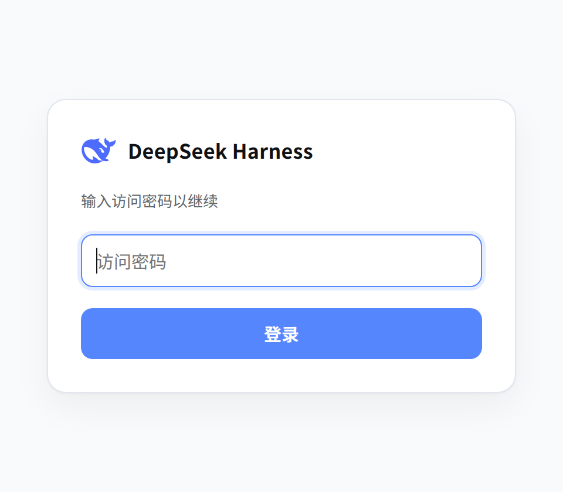
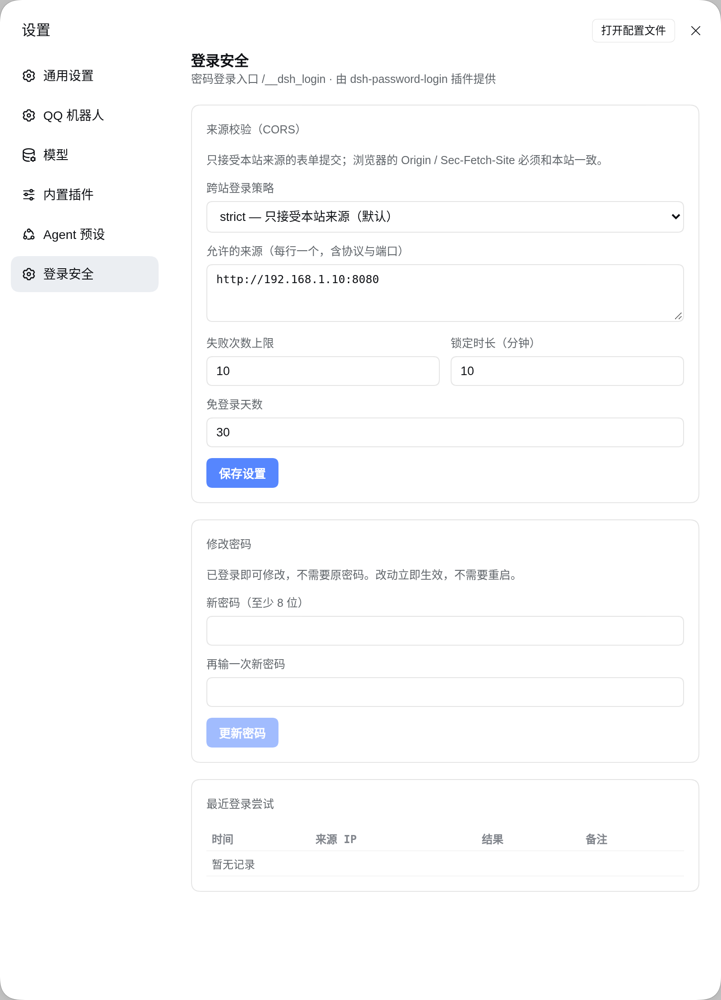

# dsh-password-login

> A password door for the [DeepSeek Harness](https://github.com/deepseek-ai) (DSH) web UI.

[中文](./README.md) | English

[](./LICENSE)
[](https://www.npmjs.com/package/@deepseek-ai/dsh)
[](https://nodejs.org)

<p align="center">
  
</p>

## Why

`dsh web` authenticates browsers with a **launch token**: it prints
`http://host:port/?token=…`, the browser trades that token for a signed,
authority-bound cookie. Solid, but the token lives in the URL — it ends up in
browser history, terminal scrollback and screenshots, and you cannot hand a
teammate "a password that works for a week".

This plugin puts a **password door** in front of that, while **reusing DSH's own
cookie mechanism**:

- an anonymous visit to `/` is redirected to the login page, and lands back on
  the requested page after signing in;
- a successful login mints a cookie with **exactly the same shape** as DSH's
  built-in BrowserAuth (same name, same HMAC payload, `HttpOnly` +
  `SameSite=Strict`), so the host's trust fence, `/api` admission and cookie
  lifetime stay untouched;
- the original `?token=` links **still work** — the plugin verifies the token
  itself;
- settings are not a separate page: they live as a **"登录安全" (Login security)
  section inside DSH's own settings dialog**.

No nginx, no extra process, no patching DSH.

## Features

- 🔐 **Password login** — scrypt (N=32768, r=8, p=1); only the hash is stored, file mode `0600`
- 🍪 **DSH-native session cookie** — configurable lifetime (default 30 days); a dsh restart does not log browsers out
- 🚪 **Return to the requested page** — `?next=` is validated and restricted to same-site paths
- 🧭 **Automatic redirect** — the plugin owns `/`; no reverse proxy required
- 🛡️ **Rate limiting** — 10 attempts / 10 minutes by default, keyed on the first `X-Forwarded-For` hop
- 🌐 **Cross-origin policy** — `strict` (default) / `allowlist` / `off`, applied immediately
- 🖼️ **Looks like the product** — DSH light palette, official whale mark
- ⚙️ **Settings inside DSH** — policy, password change and recent attempts under Settings → Login security

## Settings

<p align="center">
  
</p>

This is the only settings surface. There is no standalone settings page, so
settings can only be reached while signed in (a password login and the original
token link both count).

## Install

Requires DSH `0.2.x` and Node `≥ 20`.

```bash
# 1. install into a profile (the web profile here)
dsh plugin --profile web add github:shorekeeper-blackshore/dsh-password-login
```

```yaml
# 2. mount it in $DSH_HOME/profiles/web/cordis.patch.yml
- insert:
    - id: password-login
      name: dsh-password-login
      config:
        path: /__dsh_login
        maxAgeDays: 30
```

```bash
# 3. set a password (hidden prompt, entered twice)
npx dsh-passwd

# non-interactive
echo 'your-password' | npx dsh-passwd --stdin

# 4. restart dsh and open http://<host>:<port>/
systemctl restart dsh
```

Your existing `?token=` URL keeps working: it is exchanged for a cookie and
redirected to `/` once, after which the password is enough.

## Configuration

All optional, under `config` in `cordis.patch.yml`.

| Key | Default | Meaning |
| --- | --- | --- |
| `path` | `/__dsh_login` | login page path; must not be `/` |
| `indexPath` | `/index.html` | used to read the real index back (see below) |
| `passwordFile` | `~/.dsh/password-login.json` | the scrypt record written by `dsh-passwd` |
| `settingsFile` | `~/.dsh/password-login.settings.json` | policy / limits / lifetime from the UI |
| `maxAgeDays` | `30` | session lifetime used when the settings file is first written |

Both files are re-read on every request, so edits take effect without a restart.

## How it works

### Routes

| Method | Path | Purpose |
| --- | --- | --- |
| `GET` | `/` | valid cookie → real index; valid token → cookie; else 303 to login |
| `GET` | `/__dsh_login` | login page (redirects away when already signed in) |
| `POST` | `/__dsh_login` | verify the password, set the cookie |
| `GET` | `/__dsh_login/logout` | clear the cookie |
| `GET` | `/__dsh_login/api/state` | settings + last 20 attempts (401 when anonymous) |
| `POST` | `/__dsh_login/api/settings` | save policy / limits / lifetime |
| `POST` | `/__dsh_login/api/password` | change the password (signed in; no current password required) |

### Why the cookie can be reused

DSH's browser session cookie is an internal detail of
`@deepseek-ai/dsh-client-connection`:

```text
name   dsh-auth-<base64url(sha256(authority))>
value  v1.<base64url(JSON{version,authority,issuedAt,expiresAt})>.<base64url(HMAC-SHA256(body))>
key    the secret of the "client-connection/browser-session" credential record
attrs  Max-Age / Path=/ / Expires / HttpOnly / SameSite=Strict (+ Secure on TLS)
```

Because the plugin runs inside the host process it can read the same secret via
`ctx.credentials.readRecord()`, so the cookie it signs is accepted as-is — no
patch to DSH, no change to its authentication logic.

The trade-off: this format is a private implementation. **Re-check it after a
DSH major upgrade** — the header comment in `lib/index.js` points at the exact
place.

### Why it shadows `/` only

Only `/` is registered. The real index is fetched back through
`ctx.webServer.readResource(indexPath, peer)` — the webserver documents this read
path as skipping browser authentication — so `<base href>`, the boot manifest
and asset revisions are all generated by the host, untouched.

Side effect: hitting `/index.html` directly still returns the host's plain 401.
`/` is the ordinary entry point, so this is acceptable; assets, `/plugins/*` and
`/api` keep their normal dispatch.

### Reverse proxies

The plugin does not depend on one. Everything — login, redirect, cookie — happens
in-process; nginx only needs to forward bytes:

```nginx
location / {
  proxy_pass http://127.0.0.1:3080;
  proxy_http_version 1.1;
  proxy_set_header Host $http_host;
  proxy_set_header Upgrade $http_upgrade;
  proxy_set_header Connection "upgrade";
  proxy_set_header X-Forwarded-For $proxy_add_x_forwarded_for;
  proxy_set_header X-Forwarded-Proto $scheme;
}
```

Rate limiting keys on the first `X-Forwarded-For` hop, so clients behind the
proxy are still told apart.

## Security notes

- **Put it behind TLS.** The password goes over the wire in clear text otherwise;
  bind to loopback or serve it over HTTPS.
- Only a scrypt hash is stored, file mode `0600`; changing the password takes
  effect immediately and does not invalidate existing sessions.
- Rate limiting is an in-process counter: it resets on restart and stops online
  guessing, not distributed attacks.
- The cookie is `HttpOnly` + `SameSite=Strict`; `Origin: null` (opaque origin) is
  treated as "unknown" and `Sec-Fetch-Site` decides, with `cross-site` always
  rejected unless the policy is `off`.
- `/api` admission is unchanged: DSH still answers 401 on its own when the cookie
  is invalid.
- Single shared password: no user accounts, and the attempt log lives in memory
  (last 20 entries) only.

## Compatibility

| Item | Version |
| --- | --- |
| DSH | `0.2.2-rc.1` (tested); `0.2.x` expected |
| Node | `≥ 20` (`fetch`, `node:readline/promises`) |
| Scope | web UI only; Linux and macOS |

## License

[MIT](./LICENSE). The whale mark comes from DSH's own `favicon.svg` (the same
official mark the sidebar uses) and is used only to match the product.
