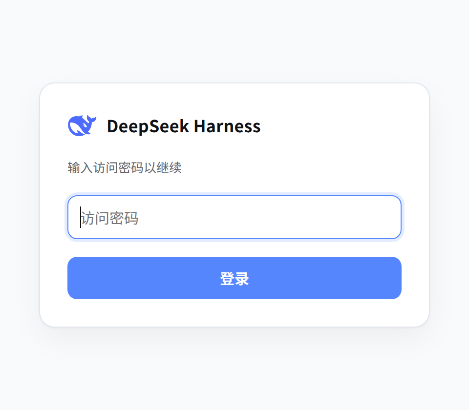
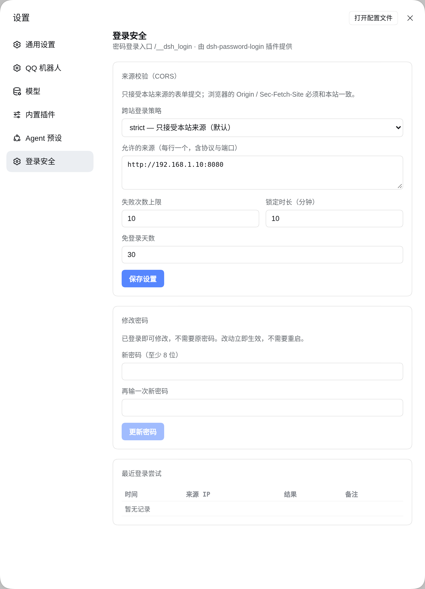

# dsh-password-login

> 给 [DeepSeek Harness](https://github.com/deepseek-ai)（DSH）的 Web UI 加一道密码门。

中文 | [English](./README.en.md)

[](./LICENSE)
[](https://www.npmjs.com/package/@deepseek-ai/dsh)
[](https://nodejs.org)

<p align="center">
  
</p>

## 它是什么

DSH 的 Web UI 默认用**启动 token** 认证：`dsh web` 会打印一个形如
`http://host:port/?token=…` 的地址，浏览器拿这个 token 换一个绑定 authority 的签名
cookie。这套机制本身很稳，但 token 在 URL 里——它会进浏览器历史、进终端日志、进截图，
而且没法"给同事一个能用一周的口令"。

这个插件在前面加了一层**密码门**，同时**复用 DSH 自己的 cookie 机制**：

- 未登录访问 `/` → 跳到自己的登录页，登录后回到原地址；
- 登录成功 → 签发**和 DSH 内置 BrowserAuth 完全同构**的 cookie（同样的名字、同样的
  HMAC 载荷、同样的 `HttpOnly` + `SameSite=Strict`），因此 DSH 的信任边界、
  `/api` 准入、cookie 生命周期全都不用改；
- 原来的 `?token=` 链接**依然可用**（插件自己校验，不需要再走宿主的那段逻辑）；
- 设置界面不是一个独立页面，而是**长在 DSH 自己的设置对话框里**的一段「登录安全」。

不需要 nginx，不需要额外的进程，不需要改 DSH 源码。

## 功能

- 🔐 **密码登录** —— scrypt（N=32768, r=8, p=1）哈希，只存哈希不存明文，密码文件 `0600`
- 🍪 **复用 DSH 的会话 cookie** —— 时长可配（默认 30 天），重启 dsh 也不会让已登录的浏览器掉线
- 🚪 **登录后回原页** —— `?next=` 全程校验，只允许站内路径
- 🧭 **未登录自动跳登录页** —— 由插件接管 `/`，不依赖任何反向代理
- 🛡️ **失败限速** —— 默认 10 次 / 10 分钟，按 `X-Forwarded-For` 的首跳识别真实来源
- 🌐 **跨站登录策略** —— `strict`（默认）/ `allowlist` / `off` 三档，改完立即生效
- 🖼️ **界面与 DSH 同色** —— 白色卡片、`#5686fe` 强调色，标题旁是官方小鲸鱼
- ⚙️ **设置长在 DSH 里** —— 设置 → 登录安全，改策略、改密码、看最近尝试都在这里

## 设置界面

<p align="center">
  
</p>

只有这一处设置界面：**DSH 设置 → 登录安全**。插件不提供独立的设置页，因此设置只有
"已经登录"这一种进入方式（密码登录拿到的 cookie，或原来的 token 链接换来的 cookie 都算）。

## 安装

需要 DSH `0.2.x` 与 Node `≥ 20`。

```bash
# 1. 装进你的 profile（这里以 web 为例）
dsh plugin --profile web add github:shorekeeper-blackshore/dsh-password-login
```

```yaml
# 2. 在 $DSH_HOME/profiles/web/cordis.patch.yml 里挂载它
- insert:
    - id: password-login
      name: dsh-password-login
      config:
        path: /__dsh_login
        maxAgeDays: 30
```

```bash
# 3. 设置密码：隐藏输入，交互式输两遍
npx dsh-passwd

# 非交互（脚本 / CI）
echo 'your-password' | npx dsh-passwd --stdin

# 4. 重启 dsh，然后访问 http://<host>:<port>/
systemctl restart dsh
```

> 已经有 `?token=` 的地址也没关系：token 链接会自动换成 cookie 并跳回 `/`，
> 之后就可以只用密码进。

## 配置项

都写在 `cordis.patch.yml` 的 `config` 里，全部可选。

| 键 | 默认值 | 说明 |
| --- | --- | --- |
| `path` | `/__dsh_login` | 登录页路径，不能是 `/` |
| `indexPath` | `/index.html` | 通过它把真实的首页读回来（见下文） |
| `passwordFile` | `~/.dsh/password-login.json` | `dsh-passwd` 写、登录时读的 scrypt 记录 |
| `settingsFile` | `~/.dsh/password-login.settings.json` | 界面里改的跨站策略 / 限速 / 时长 |
| `maxAgeDays` | `30` | 首次写入设置文件时使用的免登录天数 |

设置文件同样可热改：插件每次请求都会重新读，改完不用重启。

## 它怎么工作

### 路由

| 方法 | 路径 | 作用 |
| --- | --- | --- |
| `GET` | `/` | 有 cookie 就吐真实首页；有合法 token 就换 cookie；否则 303 去登录页 |
| `GET` | `/__dsh_login` | 登录页（已登录则直接跳走） |
| `POST` | `/__dsh_login` | 校验密码，签发会话 cookie |
| `GET` | `/__dsh_login/logout` | 清 cookie |
| `GET` | `/__dsh_login/api/state` | 当前设置 + 最近 20 次尝试（未登录 401） |
| `POST` | `/__dsh_login/api/settings` | 保存跨站策略 / 限速 / 免登录天数 |
| `POST` | `/__dsh_login/api/password` | 改密码（已登录即可，不需要原密码） |

### 为什么 cookie 能直接复用

DSH 的浏览器会话 cookie 是 `@deepseek-ai/dsh-client-connection` 的内部实现，形状是：

```text
名字  dsh-auth-<base64url(sha256(authority))>
值    v1.<base64url(JSON{version,authority,issuedAt,expiresAt})>.<base64url(HMAC-SHA256(body))>
密钥  ctx.credentials 里 "client-connection/browser-session" 这条记录的 secret
属性  Max-Age / Path=/ / Expires / HttpOnly / SameSite=Strict （TLS 下再加 Secure）
```

插件在宿主进程里，能通过 `ctx.credentials.readRecord()` 拿到同一个密钥，于是签出来的
cookie 宿主会照单全收——**不用给 DSH 打补丁，也不用改它的认证逻辑**。

代价是这份格式是私有实现：**升级 DSH 大版本后请复核一次**（`lib/index.js` 顶部有注释
指向具体位置）。

### 为什么接管的是 `/` 而不是全部

插件只遮蔽 `/` 一个路径。拿回真实首页的方式是
`ctx.webServer.readResource(indexPath, peer)` —— webserver 文档里明确写着这条读法是
**跳过浏览器认证**的 fallback，所以 `<base href>`、启动清单、资源版本号全都是宿主
自己生成的，一个字节都没被我拼过。

副作用：直接访问 `/index.html` 仍然会拿到宿主自己的 401 纯文本。正常入口是 `/`，
所以这不算问题；资源、`/plugins/*`、`/api` 全部照旧走宿主分发。

### 和反向代理的关系

**没有关系。** 登录、跳转、cookie 全部在插件里，nginx 只需要老老实实做字节转发：

```nginx
location / {
  proxy_pass http://127.0.0.1:3080;
  proxy_http_version 1.1;
  proxy_set_header Host $http_host;
  proxy_set_header Upgrade $http_upgrade;
  proxy_set_header Connection "upgrade";
  proxy_set_header X-Forwarded-For $proxy_add_x_forwarded_for;
  proxy_set_header X-Forwarded-Proto $scheme;
}
```

限速用的来源 IP 会优先取 `X-Forwarded-For` 的第一跳，所以反代后面也能正确区分客户端。

## 安全说明

- **请配 TLS。** 密码是明文过 HTTP 的；建议放在 HTTPS 反代后面，或只在内网监听。
- 密码只以 scrypt 哈希落盘，文件权限 `0600`；改密码立即生效，不会断开已有会话。
- 失败限速是**进程内存**里的计数，重启后清零；它挡的是在线爆破，不是分布式攻击。
- `SameSite=Strict` + `HttpOnly` 的 cookie 不能跨站发送；`Origin: null`（不透明来源）
  会被当作"未知来源"，交给 `Sec-Fetch-Site` 判断，`cross-site` 一律拒绝（`off` 模式除外）。
- 插件不改变 `/api` 的准入：cookie 无效时 DSH 自己照样 401。
- 这是**单密码**方案，没有用户体系、没有审计日志落盘（最近的尝试只在内存里保留 20 条）。

## 兼容性

| 项目 | 版本 |
| --- | --- |
| DSH | `0.2.2-rc.1`（实测），要求 `0.2.x` |
| Node | `≥ 20`（用了 `fetch`、`node:readline/promises`） |
| 平台 | 只影响 Web UI；Linux / macOS 均可 |

## 许可

[MIT](./LICENSE)。鲸鱼图标取自 DSH 自带的 `favicon.svg`（同样是侧边栏用的官方 mark），
仅用于和产品保持一致。
